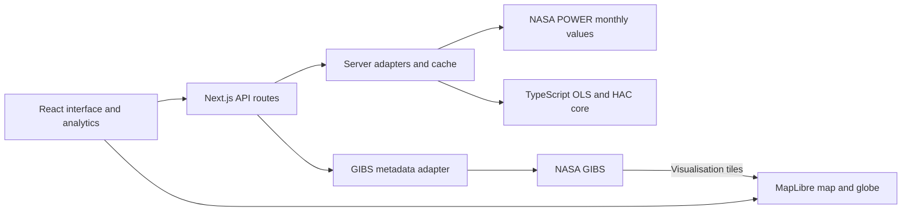
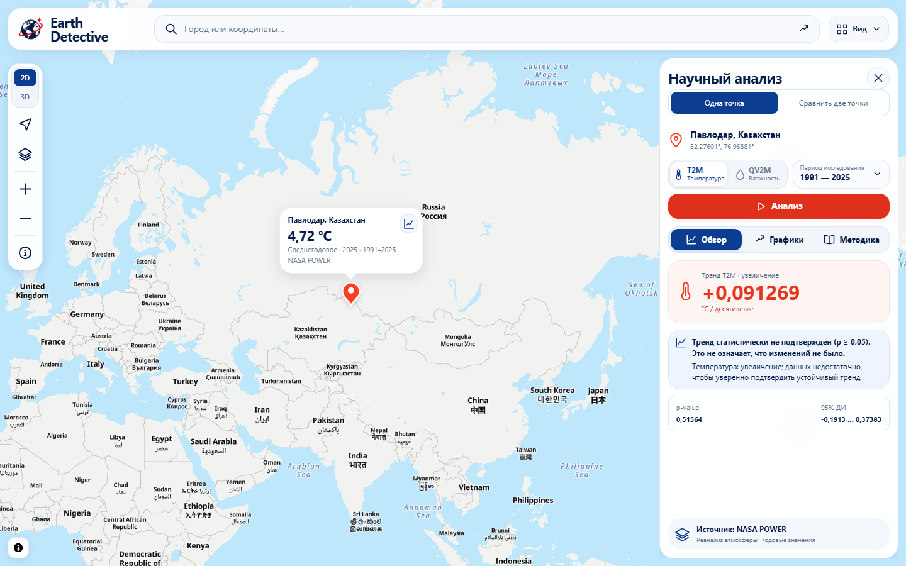
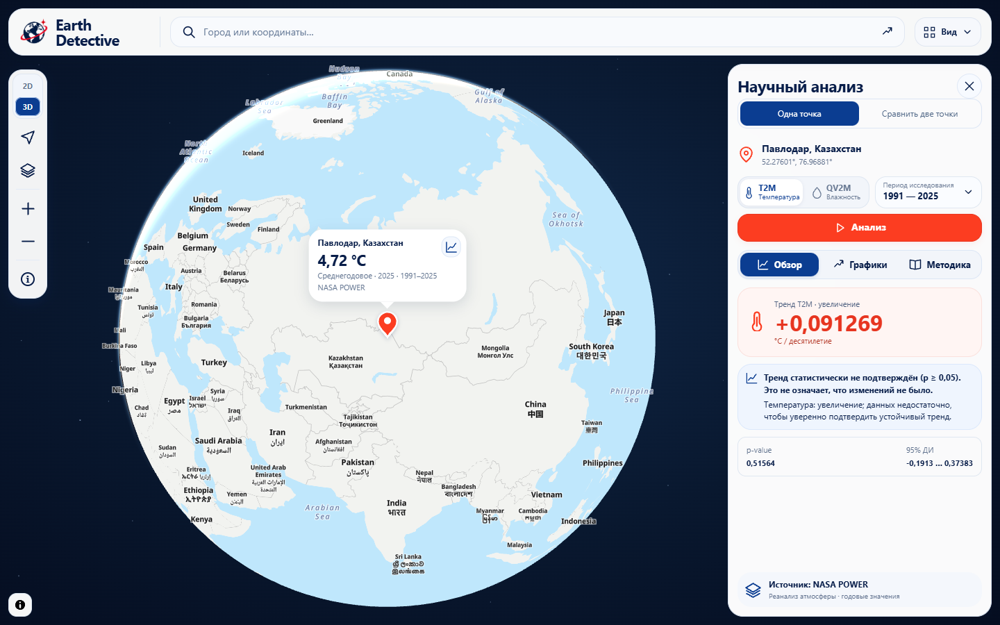
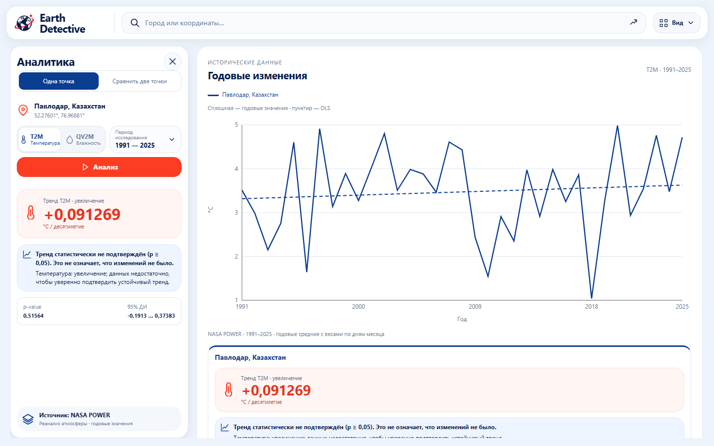
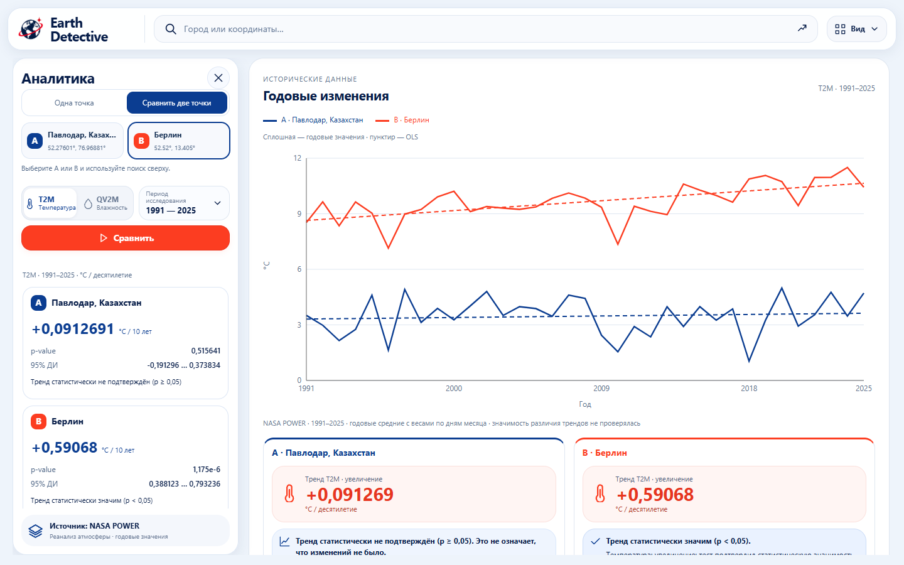

<div align="center">
  
  <h1>EARTH DETECTIVE</h1>
  <p><em>Explore Earth. Understand Change.</em></p>
  <p>An interactive platform for exploring historical Earth-system trends using NASA data and statistical analysis.</p>
  <p><strong>Team ASTRALISS | NASA Space Apps Challenge 2026</strong></p>
  <p>
    
    
    
    
    
  </p>
  <h3><a href="https://earth-detective.vercel.app/">Open the Live Application →</a></h3>
  <p><a href="#about">About</a> · <a href="#key-features">Features</a> · <a href="#scientific-methodology">Science</a> · <a href="#quick-start">Quick Start</a> · <a href="#license">License</a></p>
  <p><sub>Independent team project. Not developed, sponsored or endorsed by NASA. Contest submission status is not claimed here.</sub></p>
</div>

<details>
<summary><strong>Contents</strong></summary>

- [About](#about)
- [The Problem](#the-problem)
- [Our Solution](#our-solution)
- [Key Features](#key-features)
- [NASA Data Sources](#nasa-data-sources)
- [Scientific Methodology](#scientific-methodology)
- [Technologies](#technologies)
- [Architecture](#architecture)
- [Screenshots](#screenshots)
- [Quick Start](#quick-start)
- [Testing](#testing)
- [Limitations](#limitations)
- [Credits & Attribution](#credits--attribution)
- [License](#license)

</details>

## About

Earth Detective helps students, educators and curious explorers investigate historical temperature and specific-humidity changes at locations around the world. It connects a geographic view to actual NASA time series and explains the estimated trend alongside its uncertainty.

The current numerical analysis covers **1991–2025**. The working interface is in Russian; this README is in English for international readers.

## The Problem

Scientific archives are valuable, but choosing a dataset, checking its units, handling missing months and interpreting a trend can be difficult. A colourful map alone cannot explain whether a change is consistent over time or how uncertain a result is.

## Our Solution

**Choose Location → Get NASA Data → Analyze Trends → Understand Results**

Select a city or coordinates, choose a variable and period, and run the analysis. Review annual values, a linear trend, p-value and confidence interval. Compare two points using the same variable and period, or open **View → Analytics** for a larger workspace.

## Key Features

| Capability | What is available |
|---|---|
| Geographic exploration | Interactive MapLibre 2D map and 3D globe; city/coordinate search and point selection |
| Global temperature | NASA GIBS monthly air-temperature imagery, available-date controls and official colour legend |
| Historical point analysis | NASA POWER T2M and QV2M, fetched together; annual series and source provenance |
| Scientific inference | OLS trend, HAC/Newey–West uncertainty, two-sided p-value and 95% confidence interval |
| Two-point comparison | Distinct A/B markers, shared period and variable, individual statistical results |
| Full-screen analytics | Large single-point or combined A/B chart, solid annual lines, dashed OLS trends, hover/touch tooltip and methodology |
| Responsive interaction | Desktop/mobile layouts; cached T2M/QV2M results survive map/analytics and 2D/3D switches |

Precipitation, wind speed, a language switch and a separate light/dark UI theme are **not implemented**. The combined A/B historical chart **is implemented**; a statistical test of the difference between its two trends is not.

## NASA Data Sources

| Source | Role in Earth Detective | Official reference |
|---|---|---|
| NASA POWER | Numerical monthly point series used for annual values and trend statistics | [Monthly Point API](https://power.larc.nasa.gov/docs/services/api/temporal/monthly/), [meteorological source documentation](https://power.larc.nasa.gov/docs/methodology/data/sources_meteorology/) |
| NASA GMAO MERRA-2 | Atmospheric reanalysis underlying the selected historical meteorological products | [MERRA-2 product information](https://gmao.gsfc.nasa.gov/gmao-products/merra-2/) |
| NASA GIBS / Earthdata | Visualisation tiles for the monthly global temperature layer | [GIBS access documentation](https://nasa-gibs.github.io/gibs-api-docs/access-basics/) |

The map layer is **MERRA2_2m_Air_Temperature_Monthly**. Its month is independent of the historical analysis period; available dates are read from NASA metadata. It is neither live weather nor a forecast.

The numerical workflow uses POWER responses, not pixel colours or direct GES DISC file downloads. POWER processing/precision and GIBS visualisation are different products; their values are not promised to match exactly. POWER meteorological documentation also describes GEOS continuation products; response provenance identifies the sources returned for a request.

| Variable | Meaning | Display unit | Trend unit |
|---|---|---|---|
| T2M | Air temperature at 2 m | °C | °C per decade |
| QV2M | Specific humidity at 2 m, not relative humidity | g/kg | g/kg per decade |

Historical direct MERRA-2 reference checks are documented separately in [SCIENCE](docs/SCIENCE.md). They are not interchangeable with current POWER numerical results.

## Scientific Methodology

1. **Retrieve and validate monthly values.** Check dates, units, fill values and all 12 finite months in each year. Missing observations are rejected, not replaced by zero or silently interpolated.
2. **Aggregate by calendar days.** Annual means weight each monthly mean by its number of days, including leap years. POWER's separate annual aggregate is not the regression input.
3. **Estimate the trend.** Fit OLS with an intercept and centred calendar year; report slope per decade.
4. **Estimate uncertainty.** Apply HAC/Newey–West covariance with Bartlett weights, lag **3**, and finite-sample correction **n/(n−2)**. Use Student's t distribution with n−2 degrees of freedom for two-sided p-values and 95% intervals.
5. **Interpret cautiously.** The significance threshold is 0.05. A statistically non-significant trend **does not prove that no change occurred**; significance does not establish causation.

Point analysis represents modelled conditions near selected coordinates, **not a regional average**. Two significant individual trends do not demonstrate a significant difference between them. No separate difference-of-trends test or multiple-testing correction is implemented.

See the [scientific implementation](src/backend/science/README.md), [POWER integration](docs/P0_POWER.md) and [analytics chart verification](docs/N4C2B_ANALYTICS_CHART.md).

## Technologies

Versions below match package.json and package-lock.json at this release.

| Technology | Version / role |
|---|---|
| Node.js | 24.x runtime |
| Next.js | 16.4.6; App Router and server endpoints |
| React / React DOM | 19.3.1; interactive interface |
| TypeScript | 5.9.3; frontend, backend and scientific core |
| MapLibre GL JS | 6.18.0; map and globe rendering |
| Recharts | 3.10.1; annual series and trend charts |
| Zod | 4.6.7; runtime validation |
| h5wasm | 0.10.3; retained local direct-MERRA-2 adapter, not required for the public POWER data path |
| Vercel | Existing application hosting; no separate database |

The application requires no Python runtime and no paid API key for its standard POWER mode. Dependency licences remain separate; see [release attribution](docs/RELEASE_ATTRIBUTION.md).

## Architecture

One Next.js application and one repository, with explicit responsibility boundaries:

| Directory | Responsibility |
|---|---|
| [src/app/](src/app/) | App Router entry points and thin HTTP route handlers |
| [src/frontend/](src/frontend/) | Interface, MapLibre renderers, charts and session-local result cache |
| [src/backend/](src/backend/) | NASA adapters, validation, scientific computation and server cache |
| [src/shared/](src/shared/) | Shared schemas and types |



Scientific computation runs on the server, not inside React components or route handlers. Map dates and numerical analysis periods are separate states. [Architecture details](docs/ARCHITECTURE.md).

## Screenshots

Captured from the live N4C.2B application on **15 November 2026**, using real NASA POWER results. These are application captures, not mockups. Map/data credits remain applicable. Basemap imagery: OpenFreeMap, © OpenMapTiles, © OpenStreetMap contributors; scientific content: NASA POWER.

### 2D map



### 3D globe



### Scientific analytics



### A/B comparison



## Quick Start

Requirements: **Node.js 24.x**, npm and network access to the public data/map providers. From the repository root:

```sh
npm ci
npm run dev
```

Open [http://127.0.0.1:3000](http://127.0.0.1:3000). A fresh clone defaults to public NASA POWER mode: **no .env file, Earthdata token, database or paid service is required**. Both parameters are obtained through the server.

If your existing local environment selects another mode, set the server-only EARTH_MODE to power or remove that override. Optional settings are documented in [.env.example](.env.example); never put credentials in browser variables, commits, screenshots or issue reports. The legacy authenticated Earthdata adapter is a separate local-only path and is not required for this quick start.

For a local production run:

```sh
npm run build
npm start
```

The existing Vercel setup uses the repository root, Next.js preset, Node.js 24.x and npm run build. MapLibre worker assets are prepared by predev/prebuild.

## Testing

| Command | Purpose |
|---|---|
| npm run typecheck | TypeScript checks |
| npm run boundaries | Frontend/backend/shared import boundaries |
| npm run build | Production build, including boundary checks |
| npm test | Full automated suite; some integration checks may depend on local fixtures or network |
| node --import tsx --test tests/chart-data.test.ts | Focused chart tests: missing years, real zero values and period/variable matching |

For the N4C.2B application release, TypeScript/build/boundaries, **3 targeted chart tests** and **6 browser-check groups locally and on the public site** passed. Real single-point and A/B POWER analyses, all annual/fitted values, variable switches, hover/touch tooltip and 1440×900 / 390×844 layouts were checked. [Verification report](docs/N4C2B_ANALYTICS_CHART.md). These are recorded results, not a CI badge or a guarantee about future upstream availability.

This README-only release does not rerun the full scientific suite or production build.

## Limitations

- Model grid spacing is approximately **0.5° latitude × 0.625° longitude**; a selected point is not a weather station, city-wide measurement or area average. POWER does not expose a verified native cell centre in this response.
- Historical analysis is currently restricted to 1991–2025 and complete years, with a minimum of five years. It does not predict weather or future climate.
- NASA, map tiles and geocoding are external services; outages, rate limits and changes in coverage can delay or prevent a request.
- The GIBS display uses Mercator-compatible tiles; polar coverage beyond approximately ±85.05° is not filled with invented temperatures, including on the globe.
- A/B comparison reports two separate trends. Their statistical difference, structural reanalysis uncertainty and spatial multiple testing are not assessed.
- The browser cache is session-local. A page reload does not preserve all previous results; returning from analytics recreates the map camera around selected points.
- The interface is currently Russian. Additional variables, bilingual controls and a separate dark UI theme remain outside this release.
- The decorative sky image and third-party data retain separate terms; the author’s Apache permission covers globe code, not those resources. See [License](#license).

## Credits & Attribution

**Team ASTRALISS** develops and integrates Earth Detective. The globe reuses code contributed by an Earth Detective team member (name not supplied), now included under Apache License 2.0 with the author’s permission as confirmed by the project owner on 15 November 2026. The owner retains the correspondence privately; it is not reproduced here.

Data: **NASA POWER**, **NASA GMAO MERRA-2**, and **NASA GIBS / Earthdata**. Basemap: [OpenFreeMap](https://openfreemap.org/), [OpenMapTiles](https://openmaptiles.org/) and [OpenStreetMap contributors](https://www.openstreetmap.org/copyright). Manual place search: [Photon / Komoot](https://photon.komoot.io/). MapLibre renders the map; provider attribution remains available through its compact information control.

OpenAI Codex assisted code migration, implementation, tests and documentation. The current optional cosmic background is a new AI-created image supplied by the project owner specifically for Earth Detective. It replaces the previous image; the generating tool/model was not specified. This provenance does not establish copyright eligibility or exclusive ownership, and it is not a scientific temperature layer or NASA image. The project uses the original Earth Detective logo. **Scientific measurements are obtained from NASA, not generated by AI.**

See [NOTICE](NOTICE), [release attribution and rights exceptions](docs/RELEASE_ATTRIBUTION.md), [third-party notes](docs/THIRD_PARTY.md), and [preserved upstream licences](docs/licenses/). NASA and other providers do not sponsor or endorse the project.

## License

Original Earth Detective code and documentation are offered under the **[Apache License 2.0](LICENSE)**, subject to the scope in [NOTICE](NOTICE). Third-party dependencies, data, imagery and trademarks retain their own terms.

**Globe code:** the previous exclusion is removed for the consenting author’s code in src/frontend/map/globe-friend/. The [module provenance and file inventory](src/frontend/map/globe-friend/ORIGIN.md) record this grant without inventing an author name.

**Separate resources:** [assets/earth-detective-sky.webp](src/frontend/map/globe-friend/assets/earth-detective-sky.webp) is the owner-supplied AI-created replacement background; the old cosmic-sky.webp is no longer used. Project use and publication were requested by the owner, without a broader image redistribution/sublicensing grant. No exclusive rights or automatic copyright protection are asserted; the raster stays separate from the Apache code grant. Provider imagery/data and third-party dependencies retain their own conditions. Do not treat the complete repository, including all assets and data, as uniformly Apache-licensed. No third-party licence has been replaced.
