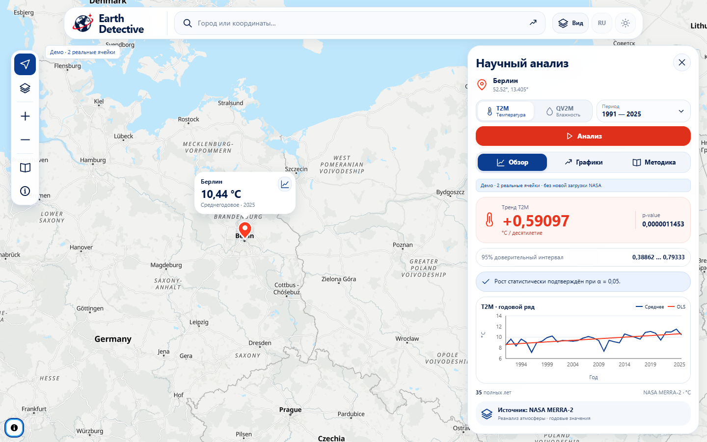
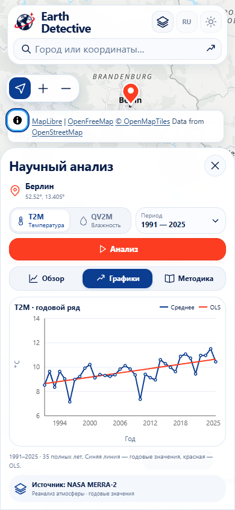

# N4A.1b — финальная визуальная полировка

Выполнено только в существующем UI. Научная логика, backend, API, NASA-источники, смысл графиков и архитектура не изменены. Следующие этапы, push и deploy не выполнялись.

## Что изменено
- Единая шкала скруглений: панели 26 px, карточки 20 px, основные кнопки/поля/dropdown 16 px, небольшие кнопки/табы/переключатели 12 px. Мобильный header 22 px, поиск 14 px; круглые иконки закрытия сохранены.
- Header центрирован и ограничен 1180 px вместо почти всей ширины окна. Уменьшены промежутки и padding, логотип 48 px вместо 54 px. На телефоне ширина — окно минус 24 px, сохранены две компактные строки и читаемый поиск.
- Атрибуция **не удалена**: включён штатный compact AttributionControl MapLibre. Маленькая info-кнопка слева снизу открывает читаемые ссылки MapLibre, OpenFreeMap, OpenMapTiles и OpenStreetMap. Native details/summary доступны клавиатурой; Enter раскрывает, Escape закрывает с сохранением фокуса. На телефоне с открытой панелью блок расположен над ней; со свёрнутой — в нижнем углу карты.

## Изменённые файлы
- src/frontend/styles/n4a1.css — визуальные правила.
- src/frontend/map/MapView.tsx — только конфигурация и поведение раскрытия атрибуции, русское название info-trigger.
- scripts/verify-n4a1b.mjs — короткая browser-проверка.
- docs/PROGRESS.md, docs/N4A1B_POLISH.md — статус и отчёт.
- docs/N4A1B_TYPECHECK.log, N4A1B_BUILD.log, N4A1B_BROWSER.log/json, N4A1B_INTEGRITY.json — доказательства; два PNG ниже.

## Проверки
TypeScript PASS, boundaries PASS, production Next.js build PASS. Короткая проверка в headless Edge: 6 групп PASS, 0 ошибок браузера. Desktop 1440×900 и mobile 390×844: header и панели внутри окна, внешнего скролла нет, табы/dropdown доступны, раскрытая атрибуция помещается в экран. Проверены открытая и свёрнутая мобильная панель. Скриншоты просмотрены визуально.

Использован один быстрый demo-анализ Berlin T2M 1991–2025 в финальном сценарии на уже сохранённых подлинных NASA данных. Свежих обращений к NASA и Earthdata token нет. Большие научные тесты не запускались. Подготовительный UI fixture не прошёл существующую проверку режима источника; научный код не менялся, проверка переключена на штатное сохранённое demo. Вспомогательная browser-проверка закрытой панели исправлена, чтобы не ждать отсутствующий aside; итоговый сценарий проходит.

Побайтовое сравнение со снимком начала этапа подтверждает: из существующих src-файлов изменены только два UI-файла выше; backend/science/API/shared и package/lock сохранены. .env не читался и не менялся. Новых зависимостей и сервисов нет.

## Новые скриншоты

Физические мобильные устройства не проверялись; язык/тема остаются подготовленными отключёнными функциями. В проверенных размерах новых известных UX-ошибок нет. Расходы **0 KZT**. После отчёта работа остановлена.
