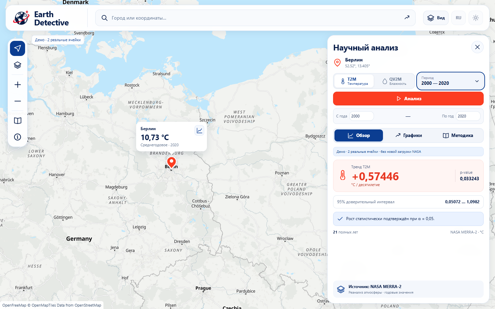
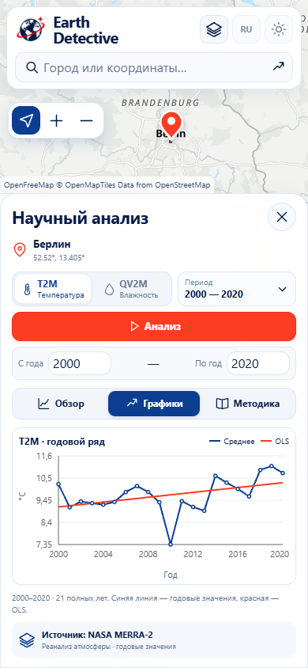

# N4A.1 — UI/UX review
Статус: выполнено, остановлено до утверждения. Только UI/UX; 0 KZT; N4A.2/N4B/3D/push/deploy не выполнялись.

## Изменения
Оригинальная эмблема + отдельное название, favicon ICO/PNG/Apple; настройки анализа перенесены в панель; доступные radio и dropdown; точный якорь маркера; карточка годового значения; удалены прямоугольники/масштаб; видимая атрибуция; компактные desktop/mobile вкладки. Расчётный backend и NASA API не изменены.

## Изменённые файлы
- `public/brand/apple-touch-icon.png`
- `public/brand/earth-detective-logo.png`
- `public/brand/favicon-32.png`
- `public/favicon.ico`
- `scripts/verify-n4a1-ui.mjs`
- `src/app/layout.tsx`
- `src/frontend/analysis/Panel.tsx`
- `src/frontend/components/App.tsx`
- `src/frontend/components/Icon.tsx`
- `src/frontend/components/PeriodSelect.tsx`
- `src/frontend/map/MapView.tsx`
- `src/frontend/map/point-summary.ts`
- `src/frontend/styles/n4a1.css`
- `src/frontend/styles/style.css`
- `src/shared/types/map.ts`

Документы: DESIGN.md, PROGRESS.md, этот отчёт; доказательства N4A1_*.json/log и два PNG ниже. Старые научные отчёты не перезаписаны.

## Проверки
- TypeScript PASS; boundaries PASS; production Next.js build PASS (N4A1_TYPECHECK.log, N4A1_BUILD.log).
- Короткая браузерная проверка: 9 групп успешно, 0 неуспешно; console/page errors: 0. Headless Edge, 1440×900 и 390×844. Native radio, dropdown/стрелки/Escape, custom period, три вкладки и три раздела Методики; отсутствие внешней прокрутки/переполнений, marker tip при трёх zoom, clear-on-new-point, reopen без повторного POST.
- Один анализ в финальном сценарии: Berlin T2M 2000–2020, offline_verified_demo, network_used=false. Использованы сохранённые настоящие NASA данные, а не свежая загрузка. Карточка показывает ровно год 2020 и API annual_series.value=10.734701421352055 °C с округлением только для отображения. Интерфейс не рассчитывает новое годовое среднее.
- 4 проверки вспомогательного отображения PASS: единицы T2M/QV2M, точный последний год, отсутствие подстановки при пропуске, пустой результат.
- Диагностические запуски выявили переполнение мобильных Расчёт/Источник, устранено; финальный сценарий проходит. Сотни научных тестов и 420-месячные загрузки не повторялись.
- 47 защищённых файлов совпадают с исходным снимком; 514 исходных файлов NASA и их сохранённые копии совпадают по SHA-256. package/lock без изменений. .env не читался, не изменялся, ignored/untracked. Новых библиотек/платных сервисов нет.

## Скриншоты

## Логотип
Найден docs/Эмблема Земли с красной орбитой.png, 1254×1254. public/brand/earth-detective-logo.png — побайтовая копия. SHA-256: `89961bdc6b528d767a11fc5d6aab0896854dc36cf04ab3d58fed6c944dfd50db`. Производные favicon получены уменьшением; оригинал не изменён. Header и favicon HTTP проверены.

## Оставшиеся ограничения
Язык и тема подготовлены как отключённые слоты. На телефоне карточка над точкой показана после закрытия панели; её кнопка возвращает панель и сохраняет результат. Физические iOS/Android и экранная клавиатура на устройствах не проверены на этом этапе. GIBS/global trend/3D, public Earthdata и deploy остаются вне этапа; прежние ограничения не сняты. Новых известных ошибок в проверенных размерах нет. Расходы **0 KZT**.
