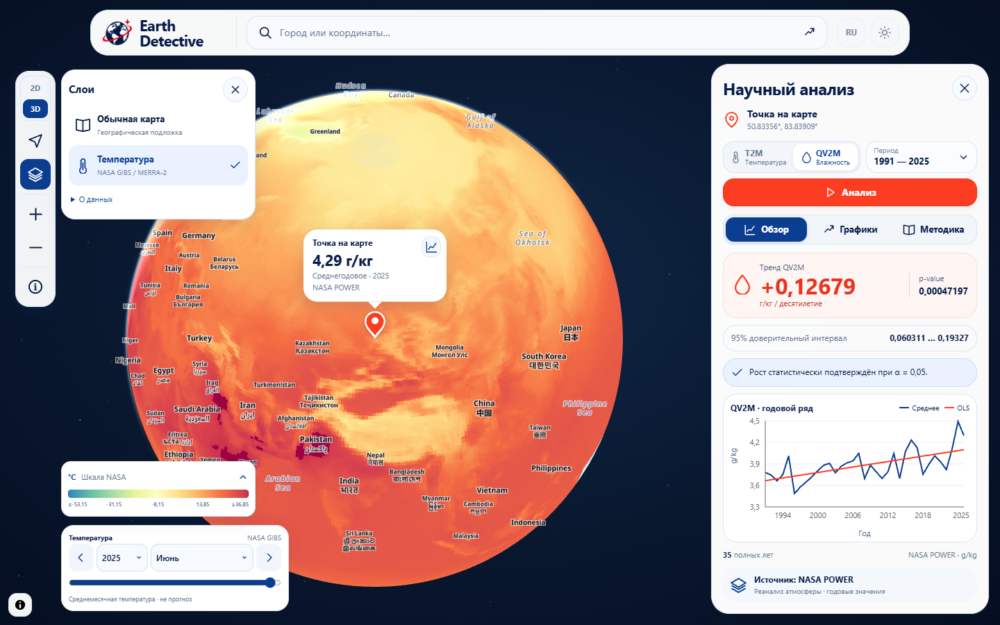
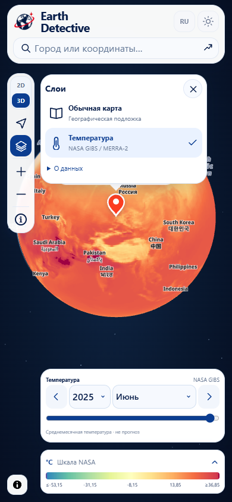
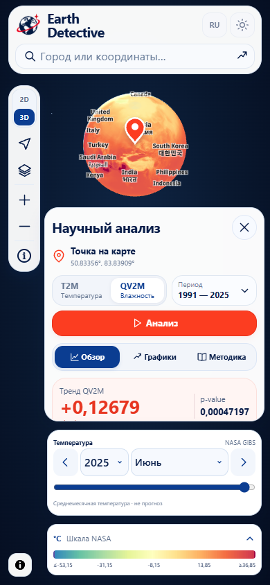

# N4B.1 — компактное управление слоями

15 ноября 2026. Только UX существующего Next.js + TypeScript. Новый проект, ветки, сервисы и научные алгоритмы не создавались.

## Изменения

- Первый экран: карта/глобус, научная панель и слои закрыты. Левый rail: 2D/3D → точка → слои → плюс → минус → сведения о карте. Активные инструменты синие. Дублирующая кнопка «Вид» из header удалена; обязательная атрибуция сохранена отдельно.
- Меню 280 px открывается единственной кнопкой «Слои». Только «Обычная карта» и «Температура NASA GIBS / MERRA-2». Выбор закрывает меню, но не научную панель; закрытие меню не отключает слой. Плавный переход 160 мс, reduced motion учитывается. Подробности в «О данных», включая единицы, происхождение, пропуски и полярное ограничение.
- Прежняя большая GIBS-карточка заменена отдельным фиксированным timebar 328×124 px слева внизу. Год, месяц, слайдер, предыдущий/следующий доступный месяц. Мобильный блок 310×124 px при 390×844. Только даты существующего каталога GIBS; пропущенные месяцы недоступны. Слайдер скрывается у обычной карты. Повторное включение возвращает дату.
- Легенда вынесена отдельно и свёрнута по умолчанию. Сохранены все 182 цвета официального ColorMap, подписи °C и NASA. Разворачивание не двигает timebar. Дата карты не меняет период POWER.
- Научная панель открывается/закрывается независимо. Сохранены T2M/QV2M, обзор/графики/методика и PairCache. На mobile нижняя научная панель получает собственную внутреннюю прокрутку: настройки не вытесняют результаты в область нулевой высоты. Графику выделено 250 px, основная страница не прокручивается.
- Камера учитывает занятое mobile-интерфейсом пространство; меняется только padding, не выбранные координаты. Левый rail вертикальный, native-атрибуция доступна в 2D и 3D. При раскрытии источники вынесены в читаемый popover выше нижних контролов.

## Затронутые файлы

- src/frontend/components/App.tsx — независимые меню и начальное закрытое состояние научной панели, обновлённый toolbar.
- src/frontend/gibs/LayerMenu.tsx — компактное меню реальных слоёв.
- src/frontend/gibs/TemperatureControls.tsx — отдельные timebar и legend.
- src/frontend/styles/n4b.css — компоновка, responsive, internal scroll, анимация и атрибуция.
- src/frontend/map/MapView.tsx, GlobeMapView.tsx; src/shared/types/map.ts — только UI-признак timeControlsVisible и camera padding.
- src/frontend/map/overlays/contracts.ts — список двух доступных base layers и type-only контракт будущего ветра.
- src/app/layout.tsx — маркер версии N4B.1 для проверки deployment.
- scripts/verify-n4b1.mjs — короткий browser flow вместо повторения большого научного набора.
- docs/N4B1_* и PROGRESS.md — отчёт и доказательства проверок.

## Будущий ветер

WindOverlayAdapter — отдельный overlay над выбранным base layer. Контракт предусматривает источник/атрибуцию, CRS EPSG:4326, сетку u/v в м/с, missing value, временной интервал и тип агрегации; loadFrame с AbortSignal; attach к существующей MapLibre map, setFrame, setVisible и dispose. Совместимость времени проверяет будущий поставщик адаптера: среднемесячная температура не является текущей погодой. dispose обязан освобождать свои listeners/buffers/animation frames, не удаляя host map. Работающего loader/renderer/анимации/кнопки ветра нет. Научные переменные POWER остаются только T2M/QV2M.

## Проверки

TypeScript PASS; boundaries PASS; production build PASS. **8 browser-групп PASS, 0 неожиданных console/page ошибок**. Проверены 1440×900 и 390×844, меню/закрытие/Escape, реальные режимы, год/месяц/слайдер/пропуски/prev-next, официальный ColorMap, выбор настоящей точки на глобусе, 2D/3D, сохранение результатов и периоды, внутренняя прокрутка статистики/графика/методики и атрибуция обеих проекций.

В финальном локальном прогоне один реальный POWER pair: **2480 мс**, network_used=true, T2M/QV2M по 420 месяцев за 1991–2025. Все переключения оставили ровно один POST. Само NASA I/O, кэширование и методы не изменялись. **80 защищённых файлов совпали побайтно с началом N4B.1**: backend, science, POWER/GIBS adapters, shared schemas, frontend analysis/cache, эталоны и зависимости. См. N4B1_INTEGRITY.json. Большой научный набор не повторялся.

Начальный mobile-прогон выявил недостаточную высоту области результата; до публикации исправлена внутренняя прокрутка и отдельно проверены статистика, реальный график и методика. Физические телефоны/Safari не сертифицировались. Внешние NASA/тайлы зависят от сети; обработка ошибок и fallback предыдущего этапа сохранены.

## Git/Vercel и бюджет

Только main / origin/main. Коммит реализации 9191ffb36af10f60d7a10fd58c2a072281e849c3 отправлен обычным push origin main. Публичный Vercel обновлён до N4B.1: 8 browser-групп PASS, 0 ошибок, один реальный POWER pair 1718ms, network_used=true, оба ряда420. Отчёт N4B1_PUBLIC_BROWSER.json. Secret scan staged и истории: 0 findings. Никакого force push, новых веток/проектов, переменных окружения, платных услуг или Earthdata credentials в браузере. **Расходы 0 KZT.** Ветер, локализация и другие этапы не начинались.

## Скриншоты

