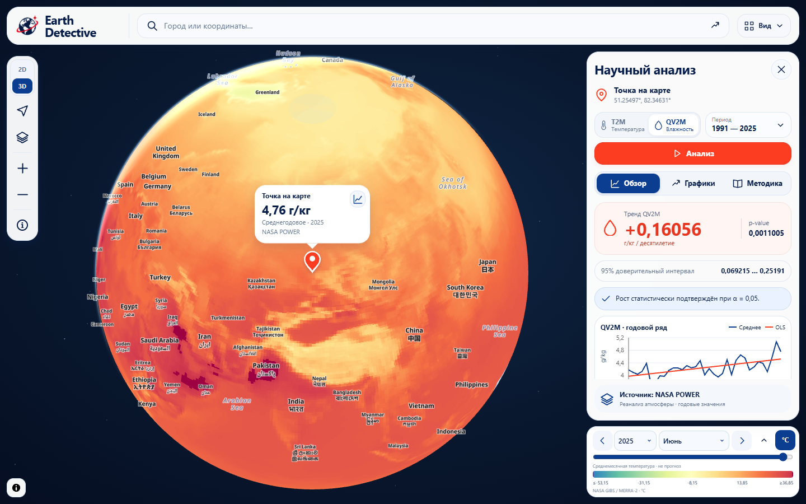
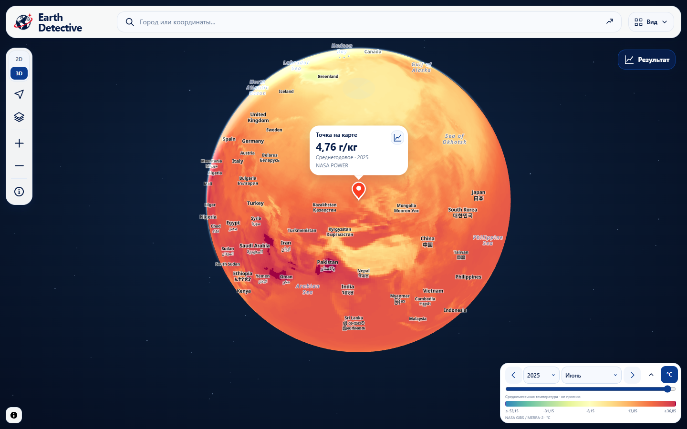
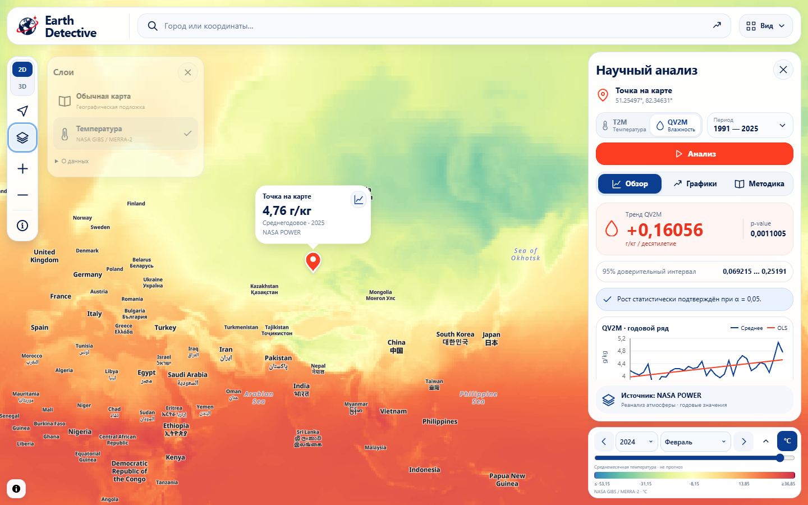
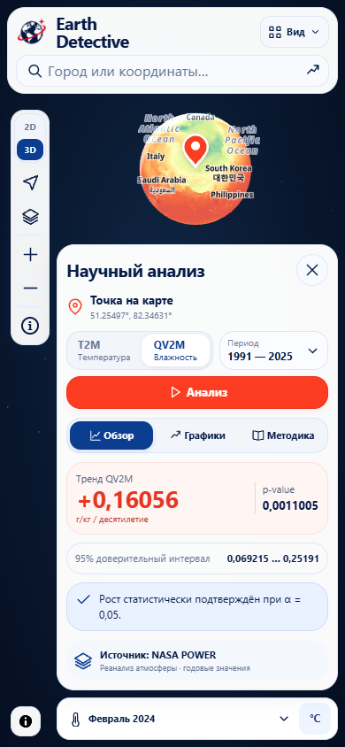

# N4B.2 — расположение по утверждённой схеме

15 ноября 2026. Карта **остаётся полноэкранной**, с плавающими элементами интерфейса. Основной экран не разделён на отдельные области: сверху header, слева инструменты, справа анализ, под ним время и легенда. Сохранены существующие компоненты, логотип, белые карточки, navy/NASA blue и красные акценты.

## Изменения

- Компактный header 68 px на desktop, поиск и действующая кнопка «Вид». В «Вид» находятся географические названия, опциональный космический фон и возврат к общему виду Земли. Неработающие кнопки языка/темы не показываются, новые функции локализации/темы не создавались.
- Карта/глобус занимают весь viewport. Левая вертикальная панель и научные карточки плавают поверх карты, как раньше. Только их расположение и свободное место для камеры согласованы со схемой.
- Справа единый плавающий контейнер: научная панель сверху, компактное управление временем и официальная легенда ниже. Ширина 380 px при 1440×900, 350 px при 1024×768. Переполняющийся научный обзор/график прокручивается внутри панели.
- При закрытии анализа сохраняются результаты и выбранная переменная; справа внизу остаётся только небольшой time dock, без пустой колонки. Год/месяц/слайдер и легенда сохраняются при 2D/3D и T2M/QV2M. Подробности легенды раскрываются кнопкой °C; блок времени тоже можно свернуть.
- Меню N4B.1 сохраняет два рабочих режима, по умолчанию закрыто и закрывается после выбора. Никакого второго выбора слоя в header. Дата GIBS независима от периода анализа POWER.
- MapLibre-глобус участника команды, проекции, источники, атмосфера и CSS-звёзды сохранены. Новый camera-layout.ts вычисляет только screen-space padding и обзорный zoom штатной камеры по размеру свободного места и публичному FOV MapLibre. Нового renderer/WebGL-глобуса нет. Географические данные и координаты выбранной точки не изменяются.
- Камера плавно учитывает плавающие header/toolbar/правую панель; выбранный маркер остаётся виден. При ручном zoom пользователь сохраняет масштаб. Для обзорного вида используются поддерживаемые MapLibre пределы zoom; при невозможности вписать полярный обзор камера может сместить центр взгляда к широте ±75°, сохраняя саму выбранную точку и её точные координаты.
- На 390×844 анализ — нижний плавающий блок, time dock ниже него свёрнут по умолчанию и раскрывается одним нажатием. Внутренняя прокрутка статистики/графика сохранена, внешней прокрутки нет. Обязательная атрибуция остаётся доступной.

## Файлы

src/frontend/components/App.tsx; src/frontend/gibs/TemperatureControls.tsx; src/frontend/styles/n4b2.css; src/frontend/map/camera-layout.ts; src/frontend/map/MapView.tsx; src/frontend/map/GlobeMapView.tsx; src/app/layout.tsx; scripts/verify-n4b2.mjs. Документация: N4B2_LAYOUT.md, N4B2_* screenshots/reports, PROGRESS.md.

Backend/API, исходные данные GIBS/POWER, OLS/HAC, p-value/CI, PairCache, shared schemas, frontend analysis и зависимости не менялись. **80 защищённых файлов совпали побайтно** с началом этапа. См. N4B2_INTEGRITY.json. Оригинальный логотип не заменялся.

## Проверки

TypeScript PASS, boundaries PASS, production build PASS. **8 финальных browser-групп PASS**, 0 неожиданных console/page ошибок. Проверены открытый/закрытый анализ, полноэкранная карта, действующий «Вид», слои, год/месяц, реальные GIBS-тайлы и 182 цвета, 2D/3D, сохранение точки/результата/периода, 1440×900 / 1024×768 / 390×844 и атрибуция.

В финальном локальном прогоне **один реальный POWER pair 1629 ms**, network_used=true, по 420 месяцев T2M/QV2M, источник NASA POWER. Все UI-переключения оставили ровно один POST. Большой научный набор не запускался. Начальные UI-прогоны выявили приоритет ширины 1024 px и перекрытие кнопки легенды; оба исправлены до публикации, финальный прогон успешен.

Ограничения: внешние NASA/тайлы зависят от связи; физические телефоны/Safari не сертифицировались. Для небольших экранов и длинного научного обзора используется внутренняя прокрутка. Научная достоверность не выводится из цвета картинки. Прежний честный предел Mercator-покрытия GIBS ±85,05° сохранён.

## Git / Vercel / бюджет

Только main / origin/main, обычный commit/push после проверок и secret scan. Точный хеш реализации и публичная проверка добавляются после публикации. Новых проектов, веток, зависимостей, сервисов, переменных окружения или секретов в браузере нет. **Расходы 0 KZT**. Ветер, локализация и другие этапы не начинались.

## Скриншоты

