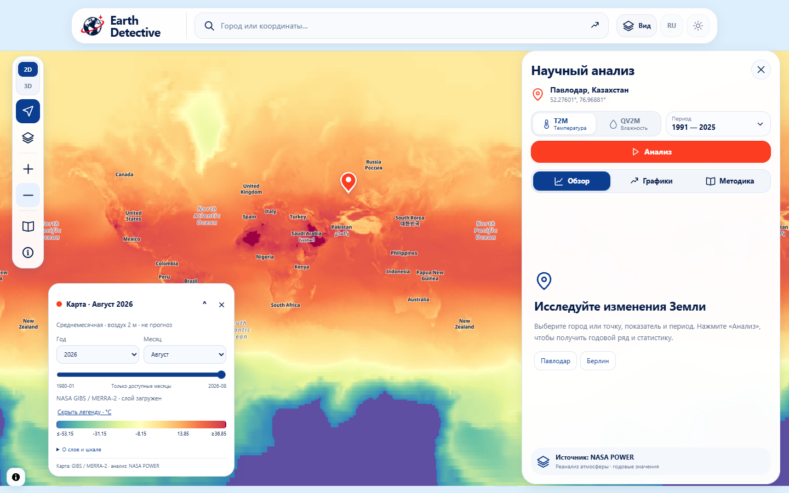
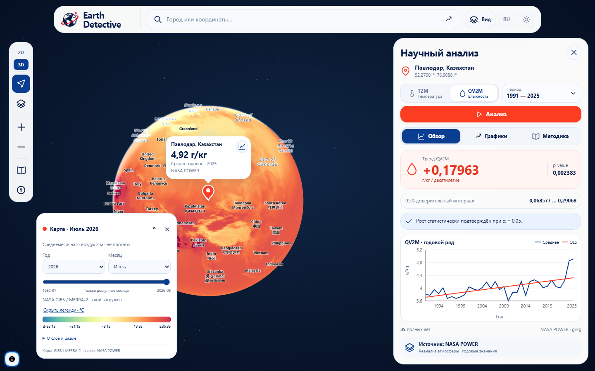
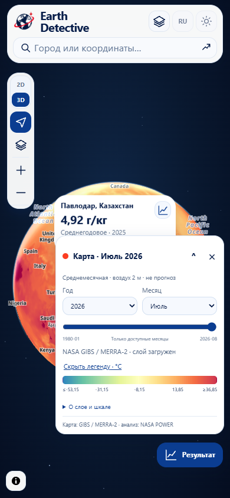

# N4B — среднемесячная температура NASA GIBS

Проверено 14–15 ноября 2026. Реализован отдельный визуальный слой **MERRA2_2m_Air_Temperature_Monthly**. Это среднемесячная температура воздуха на высоте 2 м, не текущая погода, не прогноз и не глобальный тренд. NASA POWER и ядро OLS/HAC не изменены.

## Проверенные NASA metadata

Актуальные WMTS EPSG:3857 / EPSG:4326, WMS 1.3.0 и официальный ColorMap получены HTTP 200. Сводка, SHA-256 ответов и контрольных PNG: [N4B_GIBS_METADATA.json](N4B_GIBS_METADATA.json).

- Канонические даты: **1980-01-01 — 2026-08-01**, 557 месяцев.
- Пропуски: **декабрь 2023, январь и май 2024**. Они отключены в списке месяцев, слайдер проходит только доступные даты.
- EPSG:3857 содержит ещё 57 неканонических singleton-дней апреля–июня 2025. Они исключены, а не переназначены месяцу. Берётся пересечение first-of-month дат обеих проекций. Май и июнь 2025 при этом доступны.
- EPSG:3857: **GoogleMapsCompatible_Level6**, zoom 0–6, **PNG 256×256**, XYZ адресуется как /{z}/{y}/{x}. Географические пределы ±85,05112878°.
- EPSG:4326: matrix **2km**, PNG, географическое покрытие до ±90°. Это имя сетки изображений, не обещание научного разрешения MERRA-2 в 2 км.
- WMS 1.3.0 объявляет EPSG:4326 и EPSG:3857, те же месячные интервалы. Для WMS:4326 оси latitude/longitude; WMS в приложение не подключён.
- WMTS EPSG:3413 и EPSG:3031 отвечают HTTP 200, **именно этот слой в них отсутствует**.

## Реализация

Сервер src/backend/gibs/catalog.ts получает только фиксированные публичные NASA URLs, проверяет слой, матрицы, формат и K, разбирает интервалы и официальный ColorMap. GET /api/gibs — тонкий route без научных вычислений. Ответы ограничены размером, timeout 20 с; SingleFlight и memory cache 24 ч, HTTP/CDN cache до 24 ч. Ошибка возвращает 503 без фиктивного каталога. Новых зависимостей нет.

src/frontend/gibs/use-gibs.ts хранит независимые enabled/date/metadata/status; смена времени объединяется задержкой 200 мс, устаревшие загрузки отменяются. TemperatureControls.tsx добавляет в существующие «Слои» режим «Температура», год, месяц, слайдер и раскрываемую легенду. На телефоне панель и легенда сворачиваются, а открытие настроек при открытой научной панели сначала освобождает карту. Внешней прокрутки нет.

use-temperature-layer.ts использует сохранённый createGIBSLayer и один raster source/layer в существующем MapLibre. Общий overlay передаётся MapView и GlobeMapView. Подписи остаются выше температурного растра. При выборе месяца старый слой удаляется; при переключении проекции новый renderer получает ту же дату. Координаты, переменная, период и парный POWER cache остаются в App. Смена карты/месяца/переменной не запускает POWER. Нового WebGL-контекста слой не создаёт.

PNG загружаются браузером **непосредственно с публичного gibs.earthdata.nasa.gov**, без токенов и серверного tile proxy. Протокол MapLibre nasa-gibs обрабатывает только проверенный фиксированный продукт и допустимую сетку. Timeout тайла 18 с; общий загрузочный timeout слоя 25 с. После tile error слой удаляется, отображается честная ошибка и retry; карта/3D/POWER сохраняются. Ошибки overlay отделены от ошибок WebGL/подложки.

## Палитра, полюса и ограничения

Официальный ColorMap содержит 182 цвета, единицы K. Сохранены все цвета в исходном порядке; **не генерируется собственная палитра**. Только подписи переведены K − 273,15: ≤−53,15; −31,15; −8,15; +13,85; ≥+36,85 °C. Исходный XML и оригинальная SVG-легенда доступны в metadata-ссылках. SVG со скриптами не встраивается в DOM. Пиксели не превращаются в точные температуры.

**Полярное ограничение явно показано в «О слое и шкале»:** нативный raster mesh MapLibre растягивает край Mercator-текстуры до полюса. Для этого научного слоя верхняя/нижняя строка крайнего тайла становится прозрачной, raster-resampling nearest. Остальные пиксели NASA не перекрашиваются. Это исключает ложные температуры за ±85,05°, ценой одной строки изображения на краю; у полюсов видна географическая подложка, не температура. Полного научного покрытия полярных шапок эта версия **не заявляет**. EPSG:4326 нельзя выдавать MapLibre за XYZ:3857; отдельный корректный polar renderer не добавлен.

Детализация ограничена официальным zoom 6; дальнейшее приближение увеличивает существующие пиксели. Доступность NASA и связи не гарантирована; старые браузеры без OffscreenCanvas/createImageBitmap сохраняют подложку и показывают ошибку температурного слоя. Физические телефоны и Safari не сертифицировались: проверен Edge/Chromium desktop и мобильный viewport. Продукты GIBS и POWER различаются; точного равенства их значений не обещаем. QV2M глобально не визуализируется.

## Проверки

- TypeScript PASS; boundaries PASS; production build PASS.
- **6 целевых тестов GIBS PASS, 0 FAIL**, без повторения сотен научных тестов.
- Реальные PNG января 1991, декабря 2025, августа 2026: HTTP 200, валидные PNG 256×256 с разными SHA-256.
- **7 финальных локальных browser-групп PASS**: реальные тайлы, год/месяц/слайдер и пропуски; реальный POWER pair; сохранение данных 2D/3D/QV2M; компактная атрибуция NASA; desktop 1440×900/mobile 390×844; скрытие легенды; намеренный отказ тайлов и retry; прозрачные полярные края и один живой WebGL.
- Неожиданных console/page ошибок **0**. Сетевые ERR_FAILED при искусственном abort — ожидаемые.
- Один настоящий POWER-анализ в финальном локальном прогоне: **1086 мс**, network_used=true, по 420 месяцев T2M/QV2M за 1991–2025. Переключения и смена времени карты оставили **один POST**.
- 69 защищённых файлов проверены против предыдущего HEAD: научное содержимое совпало; 48 побайтно, 21 имеют лишь существовавшую разницу CRLF/LF между рабочей папкой и Git. Эти файлы N4B не редактировались, Git diff в защищённых путях пуст. См. N4B_INTEGRITY.json.
- Начальные браузерные прогоны выявили позднее подключение 3D source и избыточную мобильную карточку; оба исправлены до публикации, финальный прогон успешен.

## Публикация и бюджет

Только существующий main / origin/main, без новых веток, проектов, force push или изменения истории. Коммит реализации **2a49f2403447172b2187a3c5ee42f10f9253e09b** успешно отправлен обычным git push origin main. main отслеживает origin/main. Security scan staged + всей истории: 0 secret findings, 0 подозрительных literals, 0 запрещённых файлов. См. N4B_SECURITY.json. Автоматический GitHub → существующий Vercel Hobby, без новых переменных окружения и сервисов.

**Расходы 0 KZT.** Earthdata credentials не нужны для GIBS, не читаются и не отправляются в браузер/репозиторий. N4C и N4A.2 не начинались. После N4B остановка.

## Публичная проверка Vercel

https://earth-detective.vercel.app обновлён до N4B. Все **7 публичных browser-групп PASS**, неожиданных ошибок 0. Реальные тайлы GIBS загрузились в 2D и 3D, дата/легенда/mobile проверены. Реальный POWER pair **1047 мс**, network_used=true, по 420 месяцев; смена даты/проекции/QV2M оставила ровно один POST. Принудительный отказ GIBS не сломал глобус и сохранённую науку, retry восстановил слой. Один живой WebGL-контекст. Подробности: [N4B_PUBLIC_BROWSER.json](N4B_PUBLIC_BROWSER.json).

Эта запись и публичные скриншоты добавлены отдельным документационным коммитом после live-проверки; код реализации не менялся.

## Скриншоты публичной версии

