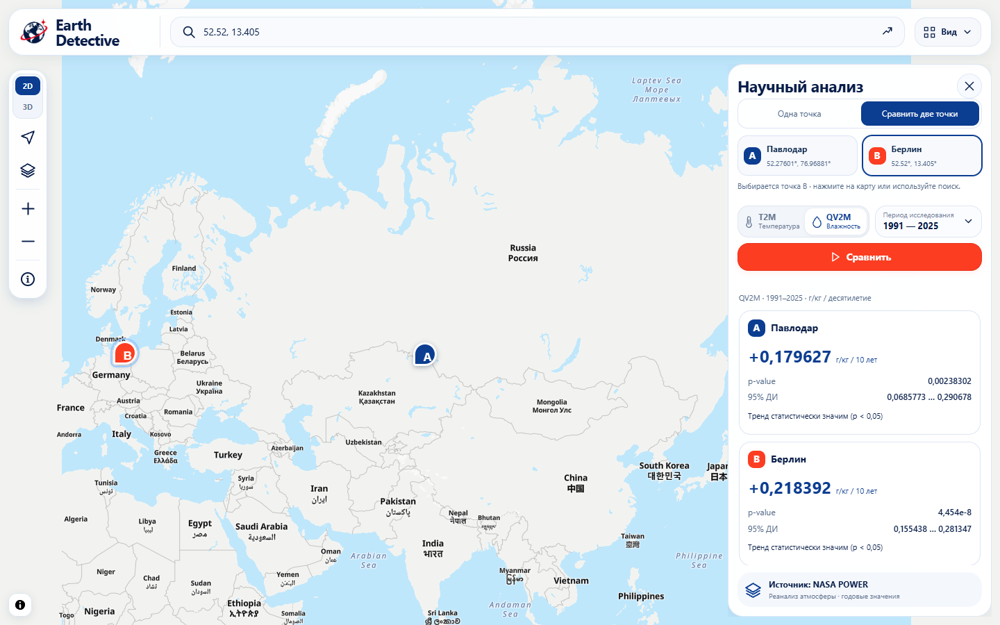
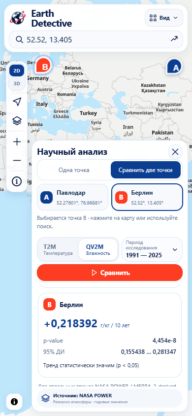

# N4C.1 — сравнение двух точек

Дата проверки: 15 ноября 2026. Бюджет: **0 KZT**.

## Реализовано

В существующей научной панели добавлен переключатель одной точки / сравнения. A — синий маркер, B — красный. Выбор активной точки, карта, быстрые города и прежний поиск (включая ввод координат) используют одно состояние. Замена A не сбрасывает B. Названия и координаты видны над общими настройками показателя и периода.

Один существующий парный POST для каждой отсутствующей в кэше точки получает T2M и QV2M. Одинаковые точки дедуплицируются в рамках запуска. Общий прежний PairCache учитывает источник, координаты и период. Переключение переменной, проекции и возврат к уже рассчитанному периоду не загружают NASA повторно. Два результата показывают тренд, p-value, 95% ДИ и значимость. Общего графика нет. Обычный анализ сохраняет прежние вкладки.

Каждый запуск привязан к координатам и периоду. Замена точки, периода или режима отменяет текущий запуск; запоздавшие ответы не записываются в новое состояние. Частичный успех сохраняется; повторный запуск повторяет только отсутствующий результат. Таймаут POWER — 30 секунд на клиенте, серверный прежний лимит не менялся.

## Реальные данные NASA POWER

1991–2025: по 420 месяцев и 35 полных лет для каждой переменной каждой точки. Павлодар 52.27601°, 76.96881°; Берлин 52.52°, 13.405°. Все четыре результата: network_used=true, прямой NASA POWER; месячные единицы C и g/kg, итоговые °C и г/кг. POWER / MERRA-2-derived не выдаётся за прямую загрузку GES DISC.

| Точка | Показатель | Тренд / десятилетие | p-value | 95% ДИ / десятилетие | Значим |
|---|---|---:|---:|---|---|
| Берлин | T2M | 0.590679779 | 0.00000117529004 | [0.388123457; 0.793236101] | Да |
| Берлин | QV2M | 0.218392367 | 4.45391472e-8 | [0.155437827; 0.281346906] | Да |
| Павлодар | T2M | 0.0912690692 | 0.515640553 | [-0.191296115; 0.373834253] | Нет |
| Павлодар | QV2M | 0.179627390 | 0.00238302006 | [0.0685772611; 0.290677520] | Да |

Методика не менялась: годовые средние с весами по дням месяца; OLS с константой, HAC/Newey–West, Bartlett lag 3, finite-sample correction, двусторонний Student t, 95% ДИ. Статистическая значимость **различия между двумя трендами не проверяется**; это явно написано в интерфейсе.

SHA-256 фактических ответов POWER:
- Берлин: f0afcc22a0c599ed142b2e7d692b9bfe0a5bed3afede66cf453075bc1b59d3fc, 2026-11-15T05:42:16.497Z
- Павлодар: c128cd30fc5505054e911686ed675c6247e9c7b4fd8137ba974a0b0ef3d76ea0, 2026-11-15T05:42:16.568Z

## Проверки

- TypeScript — PASS. Production build — PASS, 8 маршрутов. Проверка архитектурных границ — PASS.
- Семь групп браузерных проверок — PASS; неожиданных pageerror нет. Выбор A/B картой, быстрыми городами и поиском координат; реальное сравнение; T2M/QV2M и 2D/3D; замена B без сброса A; период и кэш; desktop 1440×900/mobile 390×844 без внешней прокрутки; обычный анализ и все его вкладки.
- Отдельно проверены задержанный ответ после замены B, отказ B при успешном A и повтор только B. Эти проверки воспроизводят уже полученные реальные POWER-ответы через browser interception; фиктивные научные данные не используются и дополнительные запросы NASA для проверки гонок не отправляются.
- Два настоящих POST в основном сценарии. Первый сравнительный анализ 1451 мс; переключение переменной 52 мс. Это измерения данной проверки, не гарантия времени NASA/Vercel.
- 67 защищённых файлов (backend, схемы, API-клиент, одиночная научная панель, PairCache, GIBS, модуль друга, зависимости) совпадают с исходными SHA-256. Большой научный набор не запускался.
- Проверка staged и всей доступной Git-истории: PASS, 640 blobs, 0 найденных секретов, 0 запрещённых файлов; .env, .next, node_modules и .cache исключены. Публичная проверка Vercel фиксируется ниже после публикации.

## Изменённые файлы

- src/frontend/analysis/Comparison.tsx — выбор A/B и карточки.
- src/frontend/analysis/use-point-comparison.ts — координаты, общий кэш, парные запросы, отмена и частичные ошибки.
- src/frontend/components/App.tsx — подключение режима к прежним карте, поиску и панели.
- src/frontend/map/comparison-markers.ts — DOM-маркеры A/B, охват двух точек в 2D.
- src/frontend/map/MapView.tsx, GlobeMapView.tsx — подключение маркеров к существующим renderer; без изменения 3D-движка.
- src/shared/types/map.ts — только UI-контракт маркеров.
- src/frontend/styles/n4c1.css, src/app/layout.tsx — локальные стили и маркер версии.
- scripts/verify-n4c1.mjs — ограниченная браузерная проверка.
- AGENTS.md, docs/PROGRESS.md, этот отчёт и screenshots — scope и результаты.

## Публикация

Кодовый commit и подтверждение существующего Vercel будут дописаны после push в origin/main. Новые ветки, проекты и сервисы не создавались.

## Ограничения

Кэш браузера действует в текущей сессии, ёмкость прежняя — 8 пар. Сравнение доступно в nasa_power; старый локальный Earthdata/demo не подменяет источник. На глобусе противоположные точки могут быть на разных полушариях: выбор A/B переводит камеру к соответствующей точке. В 2D действует прежний предел Mercator; полярная точка может быть вне видимой поверхности, её координаты и POWER-анализ сохраняются. NASA может временно не отвечать; ошибки показываются отдельно для каждой точки. Общий график и отдельный тест различия трендов не реализованы по заданию. N4C.2 не начат.

## Скриншоты

