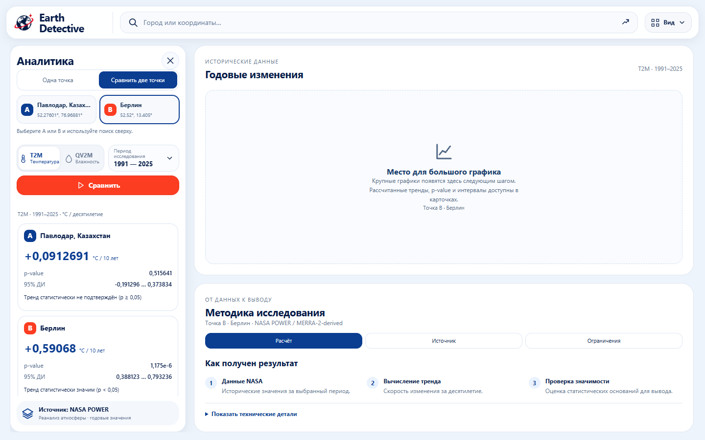
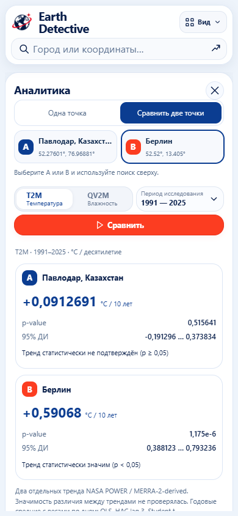

# N4C.2A — полноэкранная аналитика

15 ноября 2026. Только текущий Next.js-проект, main. Подачу на конкурс владелец выполняет вручную; статус отправки не заявляется.

- В существующем меню «Вид» добавлены «Карта» и «Аналитика», без новой страницы/приложения. Header сохранён.
- Аналитика переиспользует существующие карточки одной точки/A/B, управление переменной/периодом, общий App state и PairCache. Смена представления не отправляет NASA-запрос. Поиск сверху позволяет менять выбранную точку.
- Карта, глобус, инструменты и временной слайдер GIBS в аналитике не монтируются; WebGL освобождается. При возврате сохраняются выбранные точки, анализы, переменная, период, проекция, настройки слоёв/дата GIBS. Камера пересоздаётся вокруг выбранных точек; ручной масштаб не сохраняется.
- Показана прежняя подробная методика с источником/ограничениями для выбранной A или B. Для будущего большого графика подготовлена адаптивная область с явным текстом о подготовке. Новые и объединённые графики не добавлялись.

Проверки: TypeScript PASS; production build PASS; boundaries PASS. Шесть browser-групп PASS на 1440×900 и 390×844, 0 pageerror. Реальные NASA POWER Павлодар/Берлин: два парных POST, по420 месяцев T2M/QV2M, network_used=true. Переключения представления/переменной/3D, возврат периода из кэша и одиночный анализ — без дополнительных POST. Проверены сохранение даты GIBS, отсутствие карты/слайдера в аналитике, раскрытие методики и отсутствие внешней/горизонтальной прокрутки mobile. Полный научный набор не запускался: ядро/API/схемы/кэш не менялись. Из 83 контрольных файлов изменена только необязательная подсказка ComparisonPicker; остальные 82 побайтно сохранены.

Файлы: App.tsx; новый AnalyticsWorkspace.tsx; Comparison.tsx (только подсказка); новый n4c2a.css; app/layout.tsx (CSS/маркер версии); scripts/verify-n4c2a.mjs; AGENTS.md; PROGRESS.md; этот отчёт и два скриншота.

Ограничения: большие графики остаются N4C.2B; на mobile рабочая область прокручивается внутри экрана. На desktop карточки и методика имеют независимую внутреннюю прокрутку. Научные результаты не сохраняются после перезагрузки страницы сверх прежнего поведения.

Публикация: один кодовый commit с этим отчётом; его точный hash и результат публичной browser-проверки после push сообщаются в финальном отчёте. Новые ветки, проекты, сервисы, зависимости и переменные окружения не добавлены. Расходы **0 KZT**. N4C.2B и остальные этапы не начаты.

