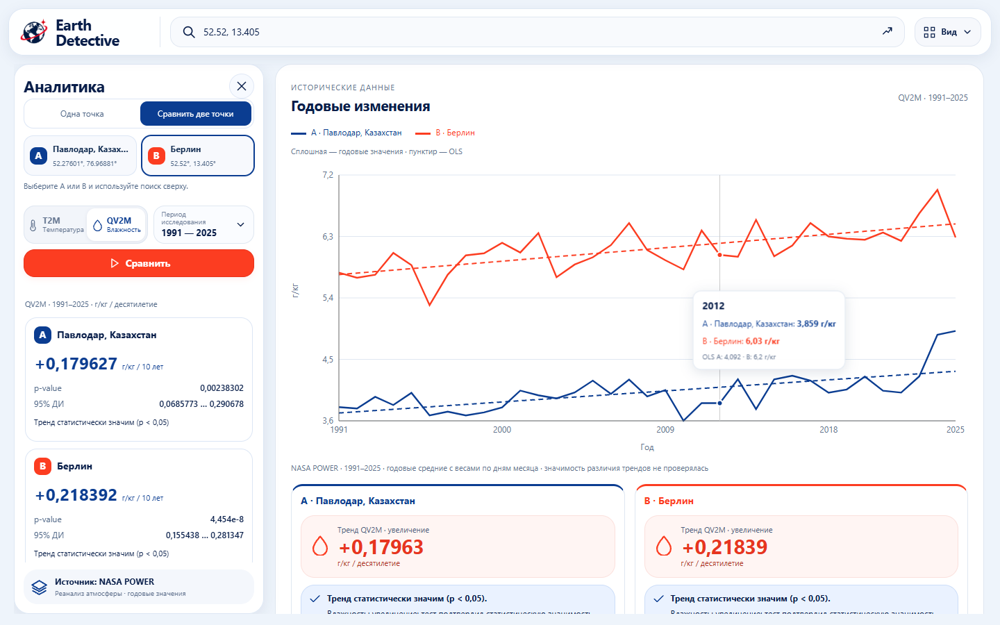
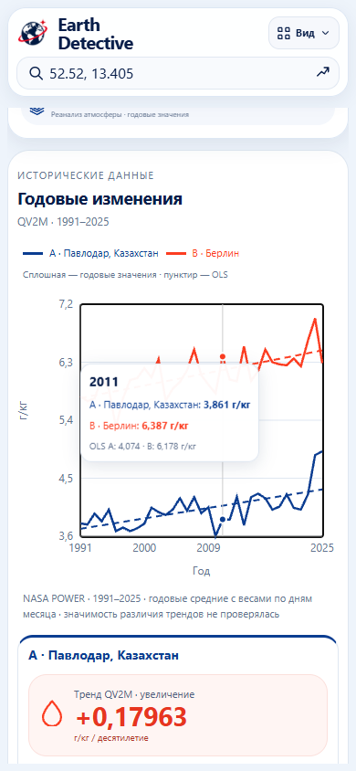

# N4C.2B — научный график аналитики

15 ноября 2026. Бюджет **0 KZT**.

- Вместо области подготовки: большой Recharts-график годовых значений NASA POWER, одиночный и A/B. Названия из App state; X — реальные годы, Y — °C либо г/кг. Desktop: высота420px, mobile320px.
- A синяя/B красная; реальные годовые значения сплошные, готовые OLS fitted_values пунктирные. Данные соединяются по календарному году; пропуски null, connectNulls=false, без нулевой подстановки или интерполяции. Результат другого периода/переменной не рисуется.
- Tooltip hover/touch показывает год, фактические годовые значения и OLS; ширина ограничена экраном. Под графиком переиспользуются Findings: тренд/направление/p-value/95% ДИ/вывод. Значимость разности трендов не утверждается.
- Нет второго API/хранилища или расчётов статистики в клиенте. Подготовка строк useMemo; backend, API, кэш, карта, GIBS, глобус и зависимости сохранены (81 файлов совпадают с исходными SHA-256). CSS использует существующие цветовые токены; новая тема не создавалась.

## Проверки

TypeScript, production build, boundaries — PASS. Три целевых unit tests: PASS, 0 failures (пропуски/настоящий ноль/готовые тренды/чужой период). Полный научный набор не запускался.

Шесть групп browser-проверок локальной production-сборки — PASS, 0 pageerror. Реальный одиночный анализ Павлодара и сравнение с Берлином за1991–2025: по420 месяцев и35 лет на переменную, NASA POWER/network_used=true. Все35 annual values и fitted_values каждой точки T2M/QV2M побайтно/численно равны переданным в модель графика значениям, статистика не пересчитывается. Ровно2 POST: A+ B; переключения T2M/QV2M, Карта/Аналитика, 3D и восстановление периода из кэша не добавили запросов. Проверены1440×900,390×844, hover/touch tooltip и отсутствие горизонтальной прокрутки.

Первый browser-прогон остановился на проверке SVG сразу после восстановления периода, до ResizeObserver Recharts. Исправлено ожидание фактической отрисовки SVG; повторный итоговый прогон прошёл полностью.

## Файлы

Новые: frontend/analysis/HistoryChart.tsx, chart-data.ts; frontend/styles/n4c2b.css; tests/chart-data.test.ts; scripts/verify-n4c2b.mjs. Изменены: AnalyticsWorkspace.tsx, App.tsx (только передача текущих результатов/названий), app/layout.tsx (CSS/версия), AGENTS.md, PROGRESS.md, этот отчёт и2 скриншота. Все frontend пути находятся в src/frontend.

## Публикация и ограничения

Commit: единый кодовый commit с этим отчётом; точный hash и результат проверки публичного Vercel после push сообщаются в финальном отчёте. Только origin/main, без force push/веток/новых проектов. Скриншоты ниже — локальная production-сборка с реальными ответами NASA.

Независимая тёмная UI-тема в текущем приложении отсутствует: сохранена существующая светлая стилистика аналитики и штатные токены, космический фон3D не изменён. При отсутствии результата график явно предлагает выполнить анализ; фиктивной демонстрации нет. Внутренняя прокрутка аналитики сохранена. Отдельного теста различия трендов нет. Другие этапы не начаты. Расходы **0 KZT**.

