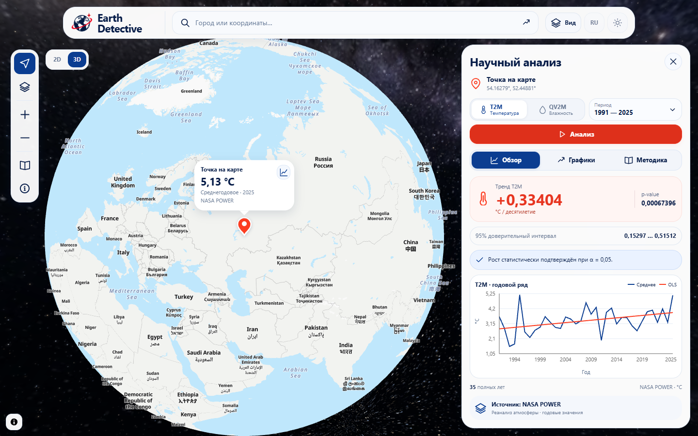
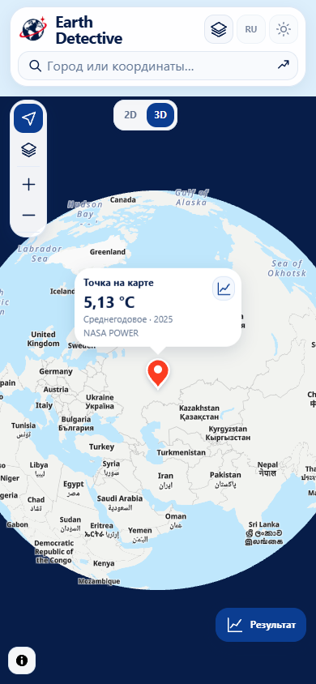

# N4G — интеграция готового глобуса

## Что перенесено
Исходник участника команды: D:\Downloads\earth detective\earth detective\src\components\earth-map. Перенесены useEarthMap/readCamera, geo-utils, render-performance, space-camera/space-renderer, SpaceBackdrop с runtime WebP и его происхождением, типы карт, LayerController и createGIBSLayer. Модули находятся в src/frontend/map/globe-friend. Логика выбора поверхности/проекции и команд камеры EarthMap использована в GlobeMapView. Это адаптация существующего MapLibre globe, новый движок не создавался. Не перенесены demo page, Tailwind/PostCSS, Lucide-панели, полигоны и демонстрационные показатели. Новых npm-зависимостей нет.

## Разрешение и источники
Владелец в задании N4G разрешил интеграцию; затем подтвердил: «он разрешил, мы в команде». Имя автора не предоставлено. Это записано как разрешение командного использования, а не выдуманная публичная MIT-лицензия. Исходные хеши/происхождение — N4G_ORIGIN.json и globe-friend/ORIGIN.md. Донорская папка не изменена. MapLibre BSD-3-Clause уже был зависимостью проекта. Космос — декоративный AI-generated арт участника, не научные данные.

В обоих режимах используются существующие OpenFreeMap/OpenMapTiles/OpenStreetMap, без EOX, demo tiles/fonts или нового картографического сервиса. Атрибуция всех этих источников + MapLibre доступна через общую native info-кнопку. Worker и его licence assets создаются существующим prebuild.

## Как работает 2D/3D
По умолчанию сохранена рабочая 2D-карта. App хранит один mode, выбранную точку, период, переменную, открытую панель и прежний PairCache с обоими результатами. MapViewport сохраняет общую камеру и монтирует только один renderer: прежний MapView или GlobeMapView с useEarthMap друга. Смена режима не вызывает analysis/cancel/reset и не меняет backend. {lat,lng} после проверки поверхности и нормализации переводится в {latitude,longitude}; клики по небу отклоняются. Наш pin и карточка результата сохранены; закрытая сфера скрывает перекрытый маркер. На desktop Globe открывается в масштабе планеты, камера управляется существующими кнопками.

MapLibre resources старого renderer уничтожаются при смене режима. Опциональный фон создаёт не более одного дополнительного контекста, не рисует постоянный idle-loop, освобождается при выключении. По умолчанию он выключен; на телефоне отключён полностью. При ошибке инициализации/загрузки/отрисовки 3D выбирается 2D, анализ сохраняется.

## Мобильная версия
Фиксированные min-height 520/620 не переносились. При открытой научной панели globe viewport занимает фактически доступную область между header и панелью; в проверке 390×844 это y=119…244, высота 125px. Планета масштабируется под эту область. Закрытие панели раскрывает глобус; результат и кнопка возврата остаются на карте. Внешнего скролла нет, есть отдельная touch-enabled проверка выбора точки и возврата в 2D. Физические телефоны и аппаратные FPS не измерялись.

## NASA POWER и N4B
Один реальный анализ точки, выбранной на 3D: 54.16279, 52.44881, 1991–2025; source=nasa_power, network_used=true. Получены T2M/QV2M по 420 месяцев и 35 лет, графики/OLS/HAC/p/95% CI работают. Тренд T2M на экране +0,33404 °C/10 лет. Весь проверочный сценарий сделал ровно 1 analysis POST; переключения переменных и режимов дополнительных запросов не создали. Backend/science не изменён.

Инфраструктура GIBS сохранена в исходниках для N4B, но слои/температурные текстуры/легенды не включены, GIBS-запросов 0. Год/месяц будущего слоя не связан с периодом анализа. selectedDate в lifecycle-hook сейчас не активирует никаких слоёв.

## Проверки
TypeScript PASS; boundaries и production build PASS; 4 коротких теста геометрии/ограничений рендера/GIBS guards PASS. Научные сотни тестов не повторялись: все 45 backend/schema/package файлов совпадают по SHA-256.

11 browser-групп PASS: рабочая 2D, globe projection, выбор в обоих режимах и sky rejection; реальный POWER pair; сохранение T2M/QV2M/периода/панели; optional sky; attribution; desktop1440×900/mobile390×844; repeated mode cleanup; forced WebGL failure; forced style load failure; touch selection. Первый анализ 1499ms. Неожиданных console/page ошибок 0. При намеренном abort стиля зарегистрирована ожидаемая ERR_FAILED; возврат в 2D прошёл. После переходов активен один MapLibre WebGL-контекст; с включённым desktop sky не более двух.

## Скриншоты

## Git/Vercel и ограничения
Только main/origin/main, обычный push без force. Хеш нового коммита и фактическая проверка автоматического deployment указываются в финальном отчёте после публикации. Публичная версия проверяется тем же сценарием; код не объявляется опубликованным до live-проверки.

Полное отключение WebGL в браузере также ограничивает прежнюю MapLibre 2D-карту: поиск/ручные координаты и научный анализ остаются доступны, но GPU-отрисовку без WebGL обещать нельзя. Проверенные 3D-специфичные сбои возвращают рабочую 2D. Внешняя подложка и NASA могут временно быть недоступны. Аппаратная производительность слабых телефонов не сертифицирована. Новых платных услуг/биллинга/проектов/веток нет. Расходы 0 KZT. После N4G остановка, N4B не начинался.
