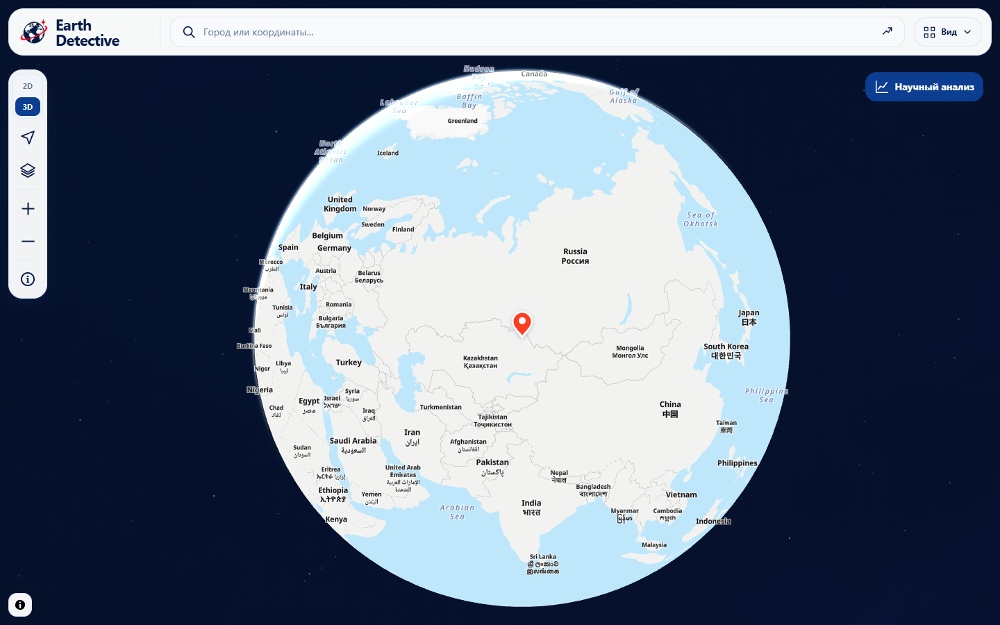
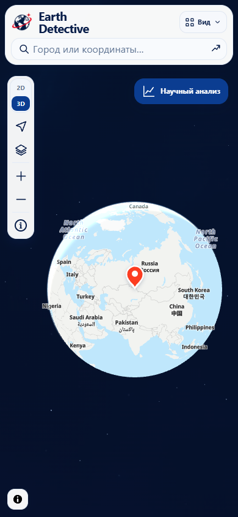

# Space background replacement

15 November 2026. Owner supplied docs/Тёмно-синяя звёздная туманность.png as AI-created specifically for Earth Detective. No specific AI tool/model, exclusive ownership or copyright eligibility is asserted. Project use/publication requested by the owner; no broader image sublicensing grant inferred.

## Resource and integration

- Old runtime cosmic-sky.webp removed; one import in SpaceBackdrop.tsx now uses earth-detective-sky.webp. No old resource references remain in executable src code. Historical filenames/hashes remain only as provenance.
- New image: 1672×941, WebP quality88/effort6, 21082 bytes (source PNG 1537360 bytes), no resize/crop. No EXIF/XMP retained. Image inspected after compression. Source SHA256 f86a67bbc73684d15d43626135aae525904287e30a8e3b27b2bf7c3a569b6080; runtime SHA256 2a6b95ca0baabad96a08c4b9dadddb645453d4da42e67d6d643308dd4754b214.
- Existing CSS panorama/dark overlay, controls, globe camera and projections preserved. Same opt-in background switch is now available on mobile; disabled by default as before. No extra WebGL context. 2D/GIBS/science/API/cache unaffected.
- Original PNG remains in its user-provided docs location, untracked and unchanged; only optimised WebP is published. Unrelated modus-trade-feedback/ is untouched and excluded.

## Checks

TypeScript PASS; production build PASS; boundaries PASS. Four local browser groups PASS at1440×900 and390×844: new image fetched and compared by SHA256, same single MapLibre canvas, mobile switch and reduced motion, 2D/3D and coordinates retained, no external page scroll,0 pageerror and0 analysis POST. 81 other protected runtime/science/config/resource files unchanged. Full scientific suite not rerun for this asset change.

Source/resource provenance updated in NOTICE, README, module assets README, ORIGIN, RELEASE_ATTRIBUTION and N4G_ORIGIN; historical licensing reports marked superseded for the old image. Root Apache code licence remains unchanged; raster scope is separate from it. Markdown links and staged/history secret scan are checked before publication.

## Publication

One commit/push in existing origin/main after checks; exact hash and public verification supplied in final response. No new branches, dependencies, projects, paid APIs or billing. **0 KZT**. Stop after this task.

