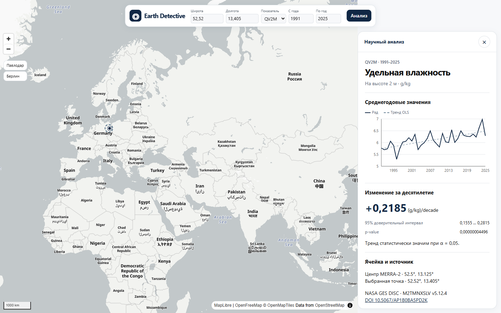
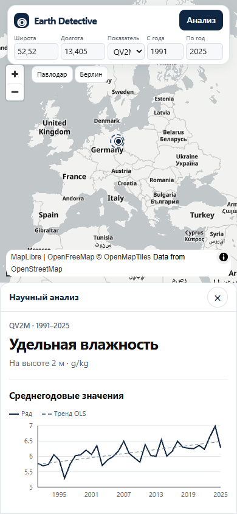

# Этап 4A · локальный интерфейс Earth Detective

React и TypeScript работают через Vite на 127.0.0.1:5173. MapLibre отображает карту с выбором точки, маркером координат и пунктирным кольцом центра ячейки после анализа. В шапке можно задать координаты и период. Слева есть масштабирование и две проверенные точки. Панель справа содержит среднегодовой ряд, линию OLS, тренд, p-value, 95% ДИ, значимость, единицы, координаты, происхождение, использование кэша и предупреждения backend.

## Файлы

- В frontend добавлены package.json, package-lock.json, .gitignore, index.html, tsconfig.json и vite.config.ts для воспроизводимой установки, сборки и проксирования локального API.
- main.tsx управляет выбором, запросом и панелью. MapView.tsx отвечает за карту, Panel.tsx отображает результат FastAPI с помощью Recharts, api.ts описывает используемые поля контракта, style.css задаёт компоновку.
- В backend/earth_detective/inference.py и schemas.py добавлено поле trend.fitted_values. Оно содержит готовые значения той же модели statsmodels OLS в порядке annual_series. Формулы, интервалы и метод обработки рядов остались прежними.
- frontend/verify.mjs проверяет локальный интерфейс в Edge. Изменения документации находятся в FRONTEND_4A.md и PROGRESS.md. Снимки браузера приведены ниже.

## Запуск в Windows

В первом PowerShell из корня проекта для демонстрации двух кэшированных ячеек:

```powershell
$env:EARTH_NASA_CACHE_DIR = 'D:\Projects\NASA\backend\.cache\integration-nasa'
& '.\backend\.venv\Scripts\python.exe' -B -m uvicorn earth_detective.main:app --app-dir backend --host 127.0.0.1 --port 8000
```

Для анализа новых ячеек запускайте в этом же окружении backend через `& '.\backend\.venv\Scripts\python.exe' -B '.\backend\run_nasa.py'` со скрытым входом Earthdata. Одновременно нужен один backend.

Во втором PowerShell:

```powershell
Set-Location 'D:\Projects\NASA\frontend'
npm.cmd ci
npm.cmd run dev -- --port 5173 --strictPort
```

Откройте http://127.0.0.1:5173/. Vite проксирует только /api/ на порт 8000. Проверку доступности и каталог интерфейс получает через GET /api/health и /api/variables, результат через POST /api/analysis. При изменении выбора предыдущий запрос отменяется на стороне клиента. Повторный запуск во время ожидания заблокирован. Закрытие панели сохраняет результат. Backend может закончить загрузку после отмены ожидания.

## Проверки

Сборка TypeScript и Vite прошла. Backend — 107 тестов прошли. Браузерный сценарий использовал настоящий FastAPI и кэш MERRA-2 за 1991–2025 годы. Для каждого запроса проверены переменная, долгота ячейки, 35 годовых значений, 35 значений OLS, две линии графика и 420 попаданий в кэш.

| Ячейка MERRA-2 | T2M, °C за десятилетие | QV2M, г/кг за десятилетие |
|---|---:|---:|
| Павлодар, 52,5° с. ш., 76,875° в. д. | +0,091795 | +0,179812 |
| Берлин, 52,5° с. ш., 13,125° в. д. | +0,590973 | +0,218503 |

Проверены получение тайлов, клик на карте, ручной ввод, переключение переменной, закрытие и открытие панели с сохранением графика. Для ошибки авторизации воспроизведён HTTP 503, для отмены использован задержанный запрос. На 1440×900, 768×1024 и 390×844 документ помещался в окне. Поиск признаков Earthdata-секретов и заголовков авторизации в прикладных исходниках не дал совпадений. Браузер обращается к локальному API и к подложке карты, вход Earthdata остаётся в backend.





## Ограничения и расходы

- На узких экранах до 600 px панель расположена снизу, чтобы сохранить видимую и доступную для клика карту. На настольном экране ширина правой панели до 400 px. Мобильная адаптация и текстовый знак логотипа представлены для визуальной приёмки.
- Холодный запрос 420 месяцев в проверке 3C занял около 195 секунд. Этап 4A проверял подключение интерфейса к кэшированным рядам. Процент загрузки интерфейс не оценивает.
- Сборщик предупреждает о размере основного JS-файла — около 471 КБ gzip. Для карты нужен WebGL и доступ к внешним тайлам. Условия OpenFreeMap предусматривают публичную подложку без регистрации, ключей и биллинга. Гарантия доступности отсутствует. Атрибуция OpenFreeMap, OpenMapTiles и OpenStreetMap видна на карте. [OpenFreeMap](https://openfreemap.org/)
- Расходы этапа — **0 KZT**. Запуск локальный. Для воспроизведения браузерной проверки при работающих серверах выполните `node verify.mjs` из frontend с установленным Edge. Скриншоты обновляются в docs.

Этап 4A ожидает проверки пользователя.

## Приёмка визуальной доработки 4A.1

До анализа настольная панель занимает высоту своего содержимого и располагается поверх карты. Она отображает выбранный показатель, годы и способ запуска. При первом открытии окна шириной до 600 px карта занимает весь экран, панель доступна по круглой кнопке. При ошибке начального подключения панель показывает сообщение и повтор подключения. После запуска анализа панель открывается сразу, а успешный ответ выводит график и статистику. В мобильном портретном окне результат получает до 66% высоты. Длинный текст прокручивается внутри панели. Крестик и кнопка открытия сохраняют уже полученный результат.

Изменены frontend/main.tsx, frontend/style.css и frontend/verify.mjs. Обновлены этот отчёт и PROGRESS.md. Для этой доработки использованы существующие API, backend и эталонные данные.

TypeScript и Vite собраны. В pytest прошли 107 тестов за 6,79 с. В Edge проверены начальные состояния, сохранение результата, ошибка и отмена, получение четырёх реальных ответов с 420 попаданиями в кэш каждый. Тренды совпали со значениями в таблице выше. На 1440×900, 768×1024 и 390×844 размеры документа укладывались в окно. На настольном и мобильном скриншотах проверены границы графика и строк p-value и 95% ДИ внутри видимой части панели. Сохраняется предупреждение сборщика о размере основного JS — 471,29 КБ gzip. Денежные расходы составили 0 KZT.

| Результат | Компьютер | Телефон |
|---|---|---|
| Павлодар, T2M | [1440×900](4A1-pavlodar-1440.png) | [390×844](4A1-pavlodar-390.png) |
| Берлин, QV2M | [1440×900](4A1-berlin-1440.png) | [390×844](4A1-berlin-390.png) |

Этап 4A.1 ожидает визуальной проверки пользователем.
